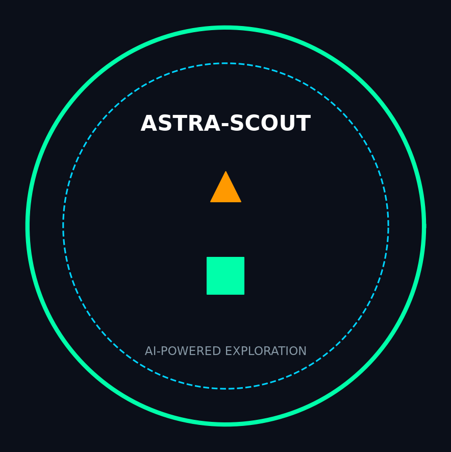

# ASTRA-SCOUT: AI-Powered Collaborative Rover–Drone Exploration



**ASTRA-SCOUT** is an autonomous multi-agent simulation framework that coordinates an aerial scout drone and a ground exploration rover to explore hazardous extraterrestrial environments (Mars and the Moon).

---

## 🌟 Key Capabilities

1. **4-Tier Distinguishable Sensor Fusion:**
   - 🛰️ **Drone Aerial Observation:** Wide-swath camera FOV ($12\text{m}$ altitude AGL), detecting macro hazards and topographical ridges.
   - 🚜 **Rover Ground Sensors:** High-resolution local surface perception ($5\text{m}$ radius), detecting micro-obstacles and verified ground truth.
   - 🧠 **AI Inferred Prior:** Spatial interpolation layer quantifying epistemic uncertainty ($\sigma$).
   - ⬛ **Unobserved Unknown:** Untracked territory handled via risk-aware caution priors.

2. **Autonomous "Scout or Drive?" Adaptive Decision Engine:**
   - Evaluates terrain complexity, obstacle density, and Expected Information Gain (EIG).
   - Computes expected energy return on investment (ROI) before launching the drone.
   - Advises mission operators whether to deploy the drone, drive directly, or conduct a targeted chokepoint reconnaissance flight.

3. **Physics-Informed Directional Energy Models:**
   - **Rover:** Calculates mechanical work considering directional incline ($\pm mg \sin\theta$), rolling resistance of planetary regolith ($C_{rr}$), motor efficiencies, and turning maneuvers.
   - **Drone:** Multirotor aerodynamic flight power model ($P_{\text{hover}}, P_{\text{cruise}}, P_{\text{climb}}$) and takeoff/landing overhead.

4. **Dynamic Replanning Engine:**
   - Simulates realistic blind rover traversal: reveals obstacles step-by-step and triggers dynamic A* replanning when paths are blocked.
   - Contrasts this against ASTRA-SCOUT's pre-cleared, cooperative, globally energy-optimal trajectory.

5. **Multi-Page Interactive Mission Control:**
   - Built with Streamlit and Plotly 3D interactive terrain surfaces.
   - Live telemetry, slope/roughness heatmaps, Monte Carlo multi-seed benchmarking.

---

## 📂 Project Architecture

```
ASTRA_SCOUT/
│
├── app.py                             # Main Entrypoint & Executive Command Dashboard
│
├── pages/
│   ├── 1_Mission_Control.py           # 3D interactive planetary map & live telemetry
│   ├── 2_Terrain_Analysis.py          # 3D DEM, slope gradients, roughness & rock classification
│   ├── 3_Scouting_Intelligence.py     # Multi-source sensor fusion & "Scout or Drive?" engine
│   ├── 4_Route_Comparison.py          # Quantitative benchmarking & Monte Carlo suite
│   └── 5_About_Project.py             # Scientific documentation & mathematical formulations
│
├── core/
│   ├── __init__.py
│   ├── environment.py                 # Planetary DEM synthesis (craters, dunes, canyons) & IO
│   ├── terrain_analysis.py            # Gradient slope, aspect, roughness & hazard indices
│   ├── sensor_fusion.py               # 4-tier provenanced multi-source observation grid
│   ├── scout.py                       # Aerial scout drone: flight planning & camera FOV projection
│   ├── rover.py                       # Surface rover: kinematics, local scanning & replanning
│   ├── decision_engine.py             # Adaptive Decision Arbiter ("Scout or Drive?")
│   ├── navigation.py                  # Multi-objective directional A* & dynamic simulation
│   └── energy_model.py                # Rover tractive physics & Drone aerodynamics
│
├── utils/
│   ├── __init__.py
│   ├── visualization.py               # Plotly 3D surfaces & multi-source heatmaps
│   └── metrics.py                     # Rigorous comparative analytics & energy savings %
│
├── data/
│   ├── sample/                        # Pre-packaged Martian & Lunar DEM archives (.npz)
│   │   ├── martian_crater.npz
│   │   ├── lunar_mare.npz
│   │   └── rugged_canyon.npz
│   └── README.md
│
├── assets/
│   └── logo.png                       # Mission patch emblem
│
├── tests/
│   ├── test_environment.py            # DEM validity & clearance tests
│   ├── test_scout.py                  # Sensor fusion layering & flight trajectory tests
│   ├── test_navigation.py             # A* optimality & dynamic replanning tests
│   └── test_energy.py                 # Incline physics & aerodynamic power monotonicity tests
│
├── requirements.txt
├── README.md
└── .gitignore
```

---

## 🚀 Quickstart Guide

### 1. Prerequisites
- Python 3.10+ (Tested on Python 3.14)
- Recommended: virtual environment

### 2. Installation
```bash
# Clone or navigate into the project directory
cd ASTRA_SCOUT

# Install dependencies
pip install -r requirements.txt
```

### 3. Run Automated Unit Tests
```bash
pytest tests/ -v
```
All 9 unit tests verify:
- DEM integrity and obstacle-free start/goal guarantees.
- Distinct 4-tier knowledge states in the sensor fusion grid.
- Dynamic replanning triggering when obstacles block rover traversal.
- Physics-based energy asymmetry (uphill > flat > downhill).

### 4. Launch Mission Control Dashboard
```bash
streamlit run app.py
```
Open your browser at `http://localhost:8501`.

---

## 📊 Scientific Honesty & Methodology
- Total mission energy includes both rover mechanical work and drone aerial flight overhead.
- Scouting is not assumed to be universally beneficial: on flat or obstacle-free terrain, drone deployment incurs flight overhead without sufficient detour savings. The Adaptive Decision Engine evaluates this trade-off explicitly.
- The simulation models directional slope work, terrain roughness, and epistemic uncertainty rather than treating path costs as abstract distance multipliers.
